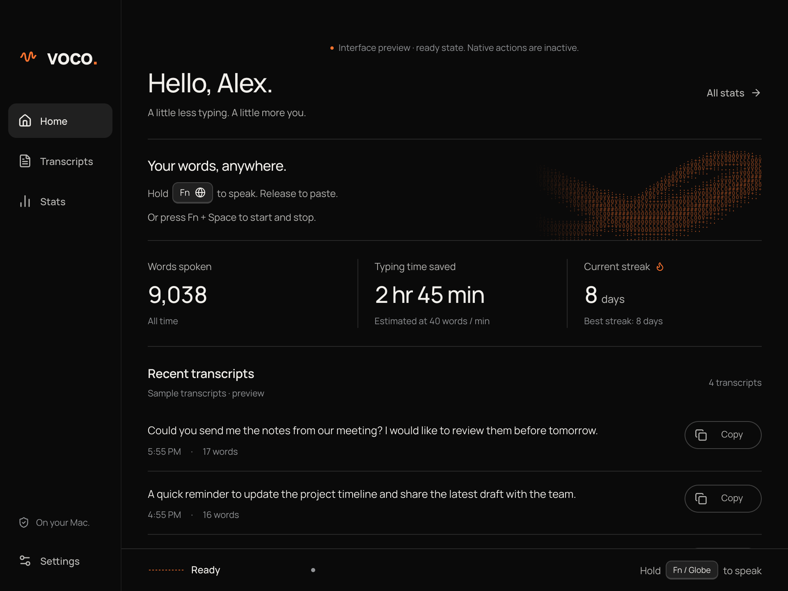

# Voco

Voco is an on-device dictation app for Apple Silicon Macs that turns speech into text at the cursor in your current app.

Hold **Fn** or **Globe**, speak, and release. Voco transcribes locally and inserts your words at the cursor. **Fn + Space** starts and stops continuous dictation. **Escape** cancels recording or pending transcription.



## Engineering highlights

- Replaced an Electron interface and Swift helper with one Rust executable. GPUI and Metal render the dashboard and recording indicator without Chromium, Node.js, or a separate helper process.
- Integrated three local speech engines, Moonshine, Parakeet, and Whisper, behind one inference worker. Recognition runs offline after model download.
- Protected text insertion with session generation IDs and destination revalidation. Cancelled results cannot commit text, and changed fields, selections, or password fields block insertion.
- Verified insertion of 2,200 UTF-16 units containing emoji, accented text, Japanese text, and line breaks in disposable native editors. Recorded checks also cover selection replacement and unsafe-destination refusal.

These are implementation and recorded verification results. The Rust port has no measured memory, startup, transcription-speed, or accuracy improvement claim. The native insertion check does not establish live microphone dictation or compatibility with every app. See the [architecture](docs/architecture.md), [current verification record](docs/gpui/verification.md), and [insertion report](docs/gpui/evidence/insertion.json).

## Build and run

Voco requires an Apple Silicon Mac with macOS 26 or newer, Rust 1.92 or newer, Apple's Command Line Tools with Swift 6.2 and the macOS 26 SDK or newer, and CMake. Speech inference dependencies include native C and C++ libraries compiled or fetched by Cargo. A first build needs internet access.

```sh
git clone https://github.com/darshmahadevia/Voco.git
cd Voco
cargo run -- --show
```

## Why I moved Voco to Rust

Voco is a Rust application. GPUI renders its dashboard and floating recording pill with Metal. Rust bindings call macOS frameworks for the menu bar, permissions, shortcuts, nonactivating windows, and text insertion. The app runs as one executable, with no browser renderer or separate helper.

I planned the Rust port to reduce the overhead and maintenance of a dictation app that stays running in the menu bar. The earlier version used TypeScript and Electron for the interface, plus a Swift helper for macOS integration.

The goals were to:

- Remove Chromium and Node.js from the app's runtime. Voco now renders its dashboard and recording pill through GPUI and Metal.
- Keep recording, shortcuts, cancellation, and text insertion in one application. Fewer process boundaries make the dictation flow easier to follow and debug.
- Use Rust's ownership and type checks to catch memory, concurrency, and state-handling mistakes before release. macOS integration and native dependencies still need runtime testing.
- Simplify packaging and updates. The app has one executable with its resources, without a separate helper process to start and coordinate.

Lower memory use and faster startup were goals of the port, but I have not measured those gains yet. The speech engines already ran native code, so the language change alone does not establish faster or more accurate transcription. The tradeoff is more platform-specific UI work if Voco expands beyond macOS.

## Install the macOS app

To install or update the macOS app from this checkout:

```sh
git pull --ff-only
./scripts/install.sh
open ~/Applications/Voco.app --args --show
```

The installer builds the current source, verifies the bundle, and replaces `~/Applications/Voco.app`. It quits a running copy and preserves settings and downloaded models. Pulling source alone does not update the installed app.

Local builds use your configured signing identity, or ad hoc signing. They are not notarized. See [development](docs/development.md) for packaging and signing.

Normal launch starts in the menu bar with the dashboard hidden. Choose **Open Dashboard** to open it. Closing the dashboard keeps Voco running. Choose **Quit Voco** from the menu bar to exit.

## Set up dictation

1. Download a speech model in the dashboard.
2. Allow Microphone and Accessibility access for **Voco**. There is no separate helper to approve.
3. Set **Press Globe key to** to **Do Nothing** in macOS Keyboard settings. Use a different shortcut for Apple Dictation.
4. Click the practice field and try holding Fn. Then dictate into a text field in another app.

Voco supports Moonshine Medium Streaming, Parakeet TDT 0.6B v2, and Whisper Large v3 Turbo in English. Model downloads use the internet. Recognition works offline after installation.

Existing Moonshine and Whisper downloads are reused. The Rust Parakeet runtime needs a separate ONNX download. Existing CoreML Parakeet files stay untouched.

Voco inserts the final transcript once. It refuses insertion if the destination app, text field, selection, or readable text changes. It does not write into password fields, press Return, or send messages. If insertion fails, copy the complete transcript from recovery. Review your words before sending them.

## Output and privacy

**Fast** keeps the speech model's transcript. **Balanced** removes fillers and spoken restarts with local rules while protecting literal text. **Accurate** adds punctuation and capitalization to Balanced output with Apple's on-device FoundationModels. It requires available Apple Intelligence and keeps Balanced output with a notice if formatting is unavailable, times out, or changes protected content.

Audio and transcript history stay in memory. Voco never saves recordings or transcripts to disk. Turning off **Keep recent transcripts** clears retained history immediately. Failed insertion text remains available for recovery. Continuous recording stops at ten minutes and transcribes the captured audio.

Settings and usage totals live in `~/Library/Application Support/Voco/settings.json`. Model files live in the adjacent `models` directory. The app migrates previous local preferences and usage totals on its first run.

## Verify

```sh
./scripts/verify.sh
VOCO_VERIFY_UI=1 ./scripts/verify.sh
cargo run -- --diagnostics
```

The [GPUI verification record](docs/gpui/verification.md) distinguishes tested behavior from hardware checks. See [architecture](docs/architecture.md) for module ownership and cancellation.

## Documentation

- [Development and installation](docs/development.md)
- [Architecture](docs/architecture.md)
- [Output modes](docs/local-dictation.md)
- [Verification commands](docs/verification.md)

Documents under `docs/migration`, the dated project audits, and the Rust migration records describe earlier builds. Use the guides above for the current app.

## License

Voco application code uses the [MIT License](LICENSE). Speech engines, model weights, and Manrope have their own licenses. The app bundles [third-party notices](Resources/licenses).
